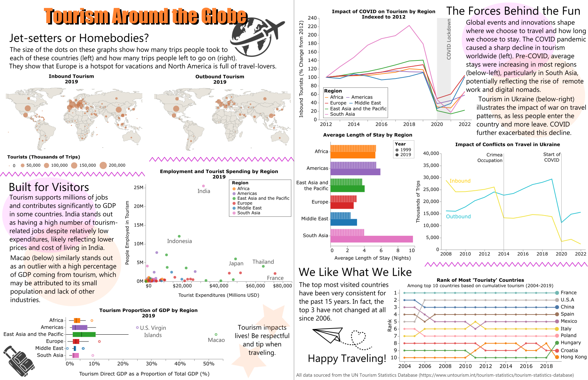

# Tourism Around the Globe
Work done for Data Visualization for Public Policy course
By Eliana Nowlis

## Description
This project explores global tourism through a variety of metrics, examining how countries' relationships with tourism differ and how major world events influence inbound and outbound tourism. It is presented in a magazine-style format to make the data and takeaways accessible and enjoyable to explore for a broad audience.

## Data Sources

All data on tourism comes from the UN Tourism Statistics Database (https://www.untourism.int/tourism-statistics/tourism-statistics-database). Included on this page are "Supplementary materials for data collection," which includes a file detailing the geographical composition of UN Tourism regions that was used to link countries to their respective regions (https://pre-webunwto.s3.eu-west-1.amazonaws.com/s3fs-public/2025-07/UN_Tourism_regions_composition.xlsx). Latitude and longitude for each country (used for the bubble map) comes from GitHub Gist "Countries coordinates with longitude and latitude" (https://gist.githubusercontent.com/metal3d/5b925077e66194551df949de64e910f6/raw/c5f20a037409d96958553e2eb6b8251265c6fd63/country-coord.csv).
