# Tourism Around the World

Eliana Nowlis

## What is your current goal? Has it changed since the proposal?
My goal right now (for the critique) is to get a better understanding of what is
actually intersting to people. There are a lot of different ways I could go with
this data and am not sure what people would most be interested in seeing. I think
I have too many ideas and now need to focus on narrowing it down.

## Are there data challenges you are facing? Are you currently depending on mock data?
Nope! My data is cleaned and I am using it for all my graphs.

## Describe each of the provided images with 2-3 sentences to give the context and how it relates to your goal.

# Image 1:
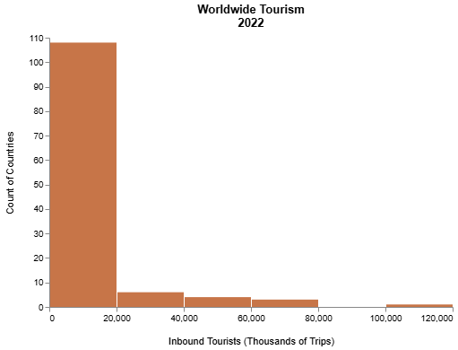

A histogram to look at the distribution of how many tourists are inbound worldwide. This is to highlight that there are a few outlier countries with a lot of tourists but most countries have a smaller amount.
# Image 2:
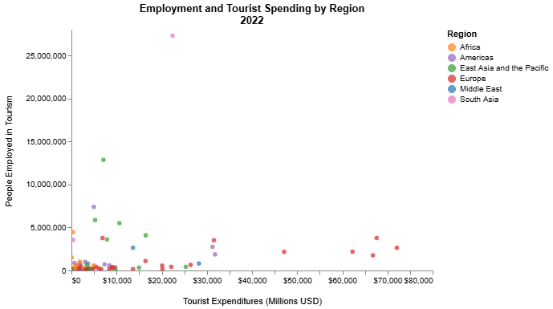

This scatterplot is best interacted with by zooming in and hovering over dots, which I think technically breaks the static image situation. I think this is to show that India is a huge outlier and also that in general Europe tends to get a lot of money from tourists without employing many people in the industry.
# Image 3:
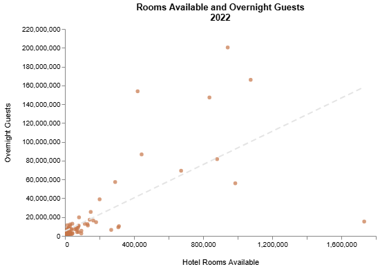

This scatterplot and regression line show the positive correlation between the number of hotel rooms available and the number of overnight guests that come to each country. While this connection is not surprising, what I think is intersting is looking at the countries that fall either far above or below this line. This is also best seen with the ability to hover and zoom which I think I need to change because it doesn't count as static.
# Image 4:
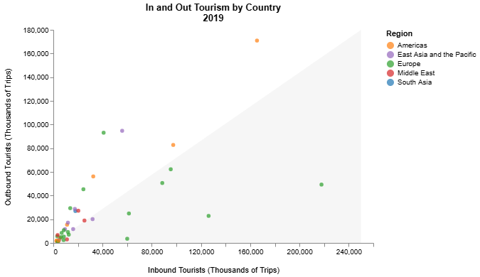

This scatterplot includes shading to show which countries are primarily destinations (more inbound than outbound tourism) vs not. It is colored by region and is meant to show that Europe tends to be a touist destination and people in the Americas travel more. I think the outliers make it hard to see general trends but are also interesting to see that they are almost all in Europe.
# Image 5:
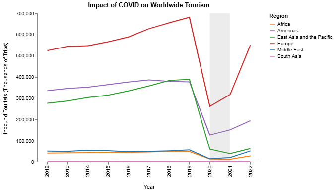

This line graph shows the drastic decline to tourism that happened due to COVID. It is shaded to show the primary years of COVID (2020 and 2021) and also shows the bounce back starting in 2022. This declined in all regions but was most pronounced in Europe.
# Image 6:
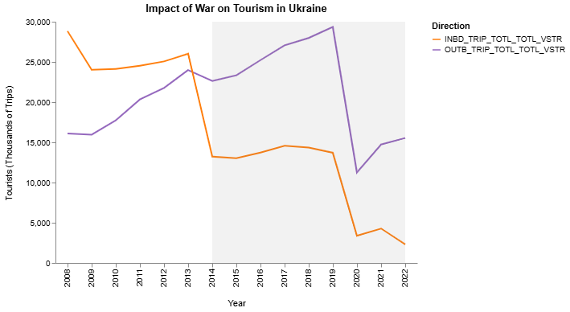

This line graph plots both the inbound and outbound tourists in Ukraine over time. The shaded area represents the time period in which Ukraine has been at war. It is clear on the graph that the inbound traffic has dropped off drastically but also that the outbound traffic increased before dropping off, a result that was interesting to me.
# Image 7:
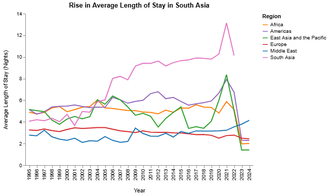

This line graph has a line for the average length of stay in each region over time. What I am reading from this is that the average length of stay in South Asia has risen dramatically over time, especially in comparison to the increase in other regions. I think this may have to do with the rise of digital nomads and working remotely.
# Image 8:
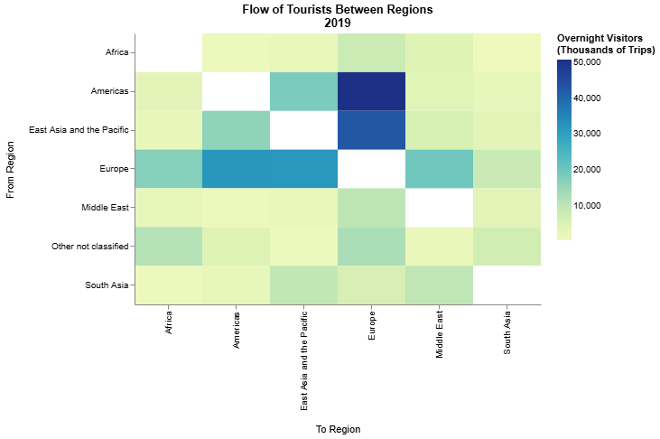

The heatmap shows where people are going to and coming from. Different regions are on each axis and the graph is colored to be darker where there is more traffic between regions. It shows that there is the most traffic from the Americas to Europe but that broadly Europe both receives and send a lot of tourists.
# Image 9:
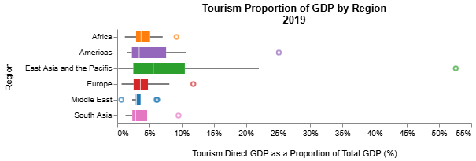

This box plot shows the spread of the percentage of GDP made up by tourism in each region. It shows that the averages are generally consistent (and small) across regions but that east asian and the pacific has a notably high outlier and a higher average in general.
# Image 10:
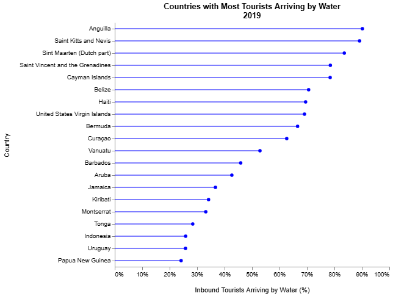

This lollipop chart gives the top 20 countries with the highest percentage of their inbound tourists arriving from the water. These are primary, and unsurprisingly islands, and I believe that some of the highest don't have an airport.
# Image 11:
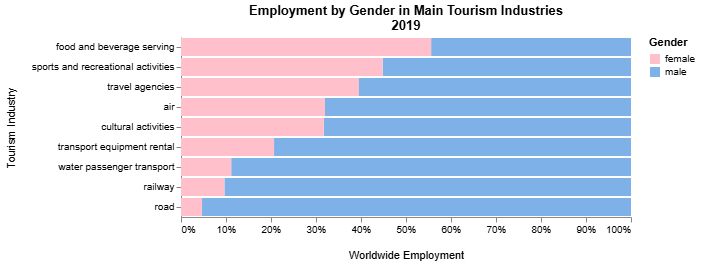

This stacked bar chart shows the percentage of men and women working in each of the tourism industries included in the database. There are more men working in almost every industry besides food and beverage service. I was surprised to see that there are comparateively more women working in sports and recreation than the other industries.
# Image 12:
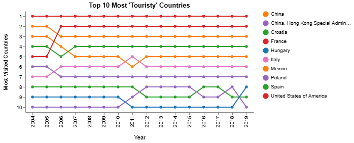

This bump chart displays the top 10 most visted countries (based on their average inbound traffic over the time period), ranked by most visited to least each year. It shows that there are generally consistant countries that get a lot of traffic and not a lot of movement among the group.

## What form do you envision your final narrative taking? (e.g. An article incorporating the images? A poster? An infographic?)
I am currently imaging something like an inforgraphic. Maybe something that a tourism office would hang on their wall. Alternatively I am imagining more of an article talking in general about the impact of world events on tourism.